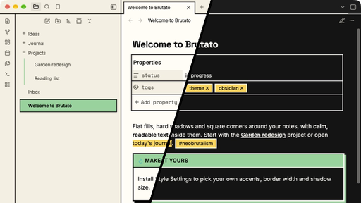

# Brutato

A neobrutalist theme for [Obsidian](https://obsidian.md). Flat fills, hard shadows, square corners and thick borders on the app around your notes, with calm, readable note text inside them. Light and dark modes.

## Features

- **One border system and one shadow style.** 2px borders, 3px for emphasis, and solid offset shadows with no blur. Every corner is square, including on phones and tablets.
- **Three accents, always behind black text.** Green for active items and buttons, yellow for tags and highlights, orange for warnings. Muted, faint and accent text all meet WCAG AA contrast (4.5:1 or higher).
- **Readable notes.** The bold treatment stays on the frame: sidebar, tabs, buttons, callouts, menus and dialogs. Note text stays quiet unless you turn on full brutal mode.
- **Bundled fonts.** Space Grotesk for headings, Inter for text and Space Mono for code, all embedded. Nothing loads from the internet.
- **Callouts with filled title bars.** Yellow for note and info, green for tip and success, orange for warning and important, coral for error and bug.
- **Canvas.** Solid-fill cards in six matching colors, ink connection lines with square ends, and bordered toolbars.
- **Graph view, Bases, Properties and embeds** styled to match.
- **File explorer.** Plus and minus folder carets, a green guide line under open folders, and roomier list spacing.
- **Clean PDF export.** Hard shadows are dropped when you export or print, while borders and colors stay.

## Install

**From Obsidian:** Settings → Appearance → Themes → Manage, search for **Brutato**, then select **Install and use**.

**Manually:** download `theme.css` and `manifest.json` from the [latest release](../../releases/latest) and put them in a folder named `Brutato` inside your vault's `.obsidian/themes` folder. Then pick Brutato under Settings → Appearance → Themes.

Requires Obsidian 1.14 or later.

## Options

Install the [Style Settings](https://github.com/mgmeyers/obsidian-style-settings) plugin to change Brutato's defaults. You'll find them under Settings → Style Settings → Brutato.

| Option | Choices |
|---|---|
| Accent 1, 2 and 3 | Any color. Pick light colors, since they sit behind black text. |
| Border width | 1 to 4px |
| Shadow offset | 0 to 10px (0 turns shadows off) |
| Dark mode shadow color | Accent 1, cream or accent 2 |
| Full brutal note text | Boxed H1, ruled H2, filled inline code and internal links, boxed quotes |
| Folder caret | Plus/minus or Obsidian's chevron |
| Canvas card style | Solid fill or tinted with a color bar |

Without the plugin, Brutato uses the defaults shown in the screenshot.

## Known limits

- Graph view nodes are drawn on a canvas, so they take Brutato's colors but not its borders or shadows.
- Canvas connection lines keep Obsidian's curved paths. For straight or right-angle lines, use the [Advanced Canvas](https://github.com/Developer-Mike/obsidian-advanced-canvas) plugin.
- The plus/minus caret and the Canvas line styles depend on Obsidian's internal class names. If an Obsidian update changes those names, these two features may need a Brutato update.
- Canvas cards with a custom color also get black text, so very dark custom colors are hard to read.

## Inspiration

Brutato follows the guidance in [Brutalist Web Design](https://brutalist-web.design/), [Neobrutalism: Definition and Best Practices](https://www.nngroup.com/articles/neobrutalism/) from Nielsen Norman Group, [neubrutalism.com](https://neubrutalism.com/) and [neobrutalism.dev](https://www.neobrutalism.dev/). The playful, snappy feel was inspired by [PostHog](https://posthog.com)'s website.

## License

Brutato is released under the [MIT License](LICENSE). The bundled fonts (Inter, Space Grotesk and Space Mono) are licensed under the SIL Open Font License 1.1. See [OFL.txt](OFL.txt).
